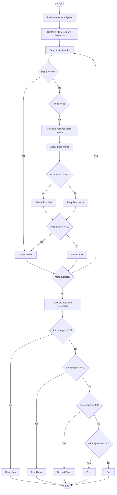

# Problem Statement
Develop a Python program to process examination marks for multiple subjects. The program should check each subject against its minimum pass mark, apply grace marks according to a specified grace-mark policy, ensure that marks never exceed the maximum marks, and finally display the student's result and classification.
# Algorithm
1. Start.
2. Read the number of subjects.
3. For each subject, read:
   - Subject name
   - Maximum marks
   - Obtained marks
   - Minimum pass marks
4. Check whether the obtained marks are greater than or equal to the pass mark.
5. If the student fails by a small margin, check whether the required grace marks are within the allowed grace limit.
6. Apply grace marks if permitted.
7. Ensure the final marks do not exceed the maximum marks.
8. Check the result of all subjects.
9. Calculate total marks and percentage.
10. Classify the student:
    - 75% and above → Distinction
    - 60%–74% → First Class
    - 50%–59% → Second Class
    - Below 50% → Pass
    - If any subject is still failed → Fail
11. Display the final result.
12. Stop.
# Mermaid Flowchart

# sample input
Enter number of subjects: 5
Enter marks for Subject 1: 78
Enter marks for Subject 2: 65
Enter marks for Subject 3: 38
Enter marks for Subject 4: 82
Enter marks for Subject 5: 55
