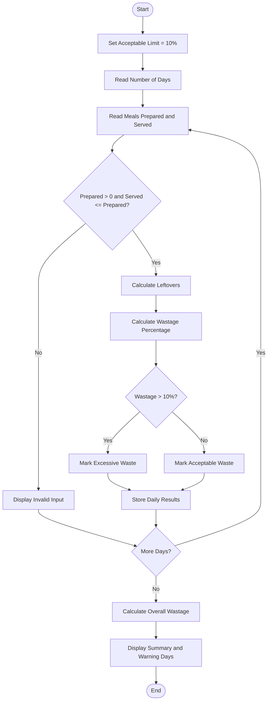

# Problem Statement
Develop a Python program to monitor food waste across several days by comparing the number of meals prepared, meals served, and meals left over. The program should calculate the food wastage percentage for each day and identify days when wastage exceeds the acceptable limit.

Assumptions:
- Wastage percentage = (Leftover meals ÷ Prepared meals) × 100
- Acceptable wastage limit = 10%
- Leftover meals = Prepared meals − Meals served
- If wastage exceeds 10%, display a warning.
- Meals served cannot exceed meals prepared.
# Algorithm
1. Start.
2. Set the acceptable wastage limit to 10%.
3. Read the number of days to monitor.
4. For each day:
   - Read the number of meals prepared.
   - Read the number of meals served.
5. Validate the input:
   - Prepared meals must be greater than zero.
   - Meals served must be between zero and prepared meals.
6. Calculate leftover meals.
7. Calculate the wastage percentage.
8. If wastage exceeds 10%, mark the day as Excessive Waste.
9. Otherwise, mark it as Acceptable Waste.
10. Store and display the daily results.
11. Calculate total meals prepared, served, and wasted.
12. Calculate the overall wastage percentage.
13. Display the days exceeding the acceptable limit.
14. Stop.
# Mermaid Flowchart

# sample input
Enter number of days: 3

Day 1
Enter meals prepared: 100
Enter meals served: 95

Day 2
Enter meals prepared: 120
Enter meals served: 100

Day 3
Enter meals prepared: 150
Enter meals served: 120
