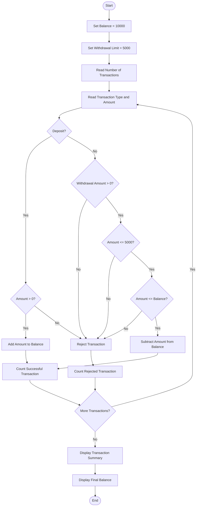

# Problem Statement
Design a Python program to simulate ATM transactions. The program should process a sequence of deposits and withdrawals, maintain the current account balance, enforce a maximum withdrawal limit, reject invalid transactions such as negative amounts or insufficient balance, and finally display a transaction summary.

Assumptions:
- Initial balance = ₹10,000
- Maximum withdrawal per transaction = ₹5,000
- Deposit amount must be greater than 0.
- Withdrawal amount must be greater than 0.
- Withdrawal is rejected if it exceeds the withdrawal limit or available balance.
# Algorithm
1. Start.
2. Set the initial balance to ₹10,000.
3. Set the maximum withdrawal limit to ₹5,000.
4. Read the number of transactions.
5. For each transaction:
   - Read transaction type.
   - Read transaction amount.
6. If the transaction is a deposit:
   - Check whether the amount is positive.
   - If valid, add it to the balance.
   - Otherwise, reject the transaction.
7. If the transaction is a withdrawal:
   - Check whether the amount is positive.
   - Check whether it is within the withdrawal limit.
   - Check whether sufficient balance is available.
   - If all conditions are satisfied, subtract the amount from the balance.
   - Otherwise, reject the transaction.
8. Count successful and rejected transactions.
9. Display the final balance.
10. Display the number of successful and rejected transactions.
11. Stop.
# Mermaid Flowchart

# sample input
Enter number of transactions: 5

Transaction 1
Enter transaction type (deposit/withdraw): deposit
Enter amount: 3000

Transaction 2
Enter transaction type (deposit/withdraw): withdraw
Enter amount: 4000

Transaction 3
Enter transaction type (deposit/withdraw): withdraw
Enter amount: 6000

Transaction 4
Enter transaction type (deposit/withdraw): deposit
Enter amount: 2000

Transaction 5
Enter transaction type (deposit/withdraw): withdraw
Enter amount: 3000
