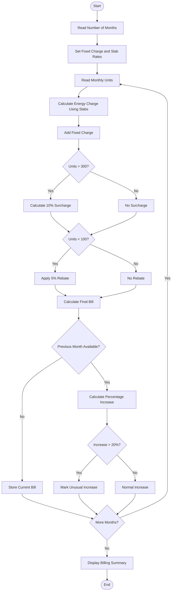

# Problem Statement
Design a Python program to calculate household electricity bills for multiple months using different consumption slabs, fixed charges, surcharges, and rebates. The program should calculate the bill for each month, compare the bills, and identify any unusual increase in the electricity bill.

Assumptions:
- 0–100 units → ₹2 per unit
- 101–200 units → ₹3 per unit
- 201–300 units → ₹5 per unit
- Above 300 units → ₹7 per unit
- Fixed charge = ₹100 per month
- Surcharge = 10% if consumption is above 300 units
- Rebate = 5% if consumption is below 100 units
- An increase of more than 20% compared with the previous month is considered unusual.
# Algorithm
1. Start.
2. Read the number of months.
3. Set the fixed charge, slab rates, surcharge rate, and rebate rate.
4. For each month, read electricity consumption in units.
5. Calculate the energy charge using the progressive slabs.
6. Add the fixed charge.
7. If consumption is above 300 units, calculate and add a 10% surcharge.
8. If consumption is below 100 units, calculate and apply a 5% rebate.
9. Calculate the final bill.
10. Compare the current month's bill with the previous month's bill.
11. If the bill increased by more than 20%, mark it as an unusual increase.
12. Display each month's bill and comparison.
13. Display the overall billing summary.
14. Stop.
# Mermaid Flowchart

#sample input
Enter number of months: 4

Month 1
Enter electricity consumption in units: 90

Month 2
Enter electricity consumption in units: 150

Month 3
Enter electricity consumption in units: 250

Month 4
Enter electricity consumption in units: 400
