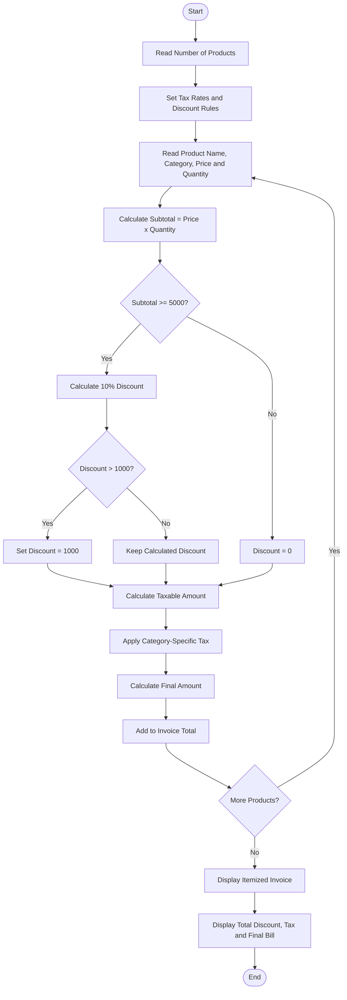

# Problem Statement
Design a Python program to generate an itemized retail invoice for multiple products. The program should calculate the cost based on product price and quantity, apply category-specific taxes, provide threshold-based discounts, and ensure that the total discount does not exceed the maximum concession limit.

Assumptions:
- Electronics → 18% tax
- Clothing → 5% tax
- Food → 0% tax
- If item subtotal ≥ ₹5,000 → 10% discount
- Maximum discount allowed per item = ₹1,000
- Final amount = Subtotal − Discount + Tax
# Algorithm
1. Start.
2. Read the number of products.
3. Set tax rates for different categories.
4. Set the discount percentage and maximum concession limit.
5. For each product:
   - Read product name, category, price, and quantity.
6. Calculate the item subtotal:
   - Subtotal = Price × Quantity
7. Check whether the subtotal reaches the discount threshold.
8. If eligible, calculate the discount.
9. If discount exceeds ₹1,000, limit it to ₹1,000.
10. Calculate the taxable amount.
11. Apply the category-specific tax.
12. Calculate the final amount.
13. Add the values to the invoice total.
14. Display the itemized invoice.
15. Display total subtotal, discount, tax, and final bill.
16. Stop.
# Mermaid Flowchart

# sample input
Enter number of products: 3

Product 1
Enter product name: Laptop
Enter category (electronics/clothing/food): electronics
Enter price: 50000
Enter quantity: 1

Product 2
Enter product name: Shirt
Enter category (electronics/clothing/food): clothing
Enter price: 1500
Enter quantity: 2

Product 3
Enter product name: Rice
Enter category (electronics/clothing/food): food
Enter price: 1000
Enter quantity: 6
