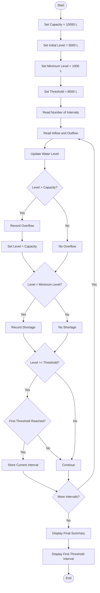

# Problem Statement
Design a Python program to simulate the water level of a tank over multiple days. The program should process the changing inflow and outflow quantities, update the water level after each interval, detect overflow and water shortages, and determine the first interval in which the water level reaches a specified threshold.

Assumptions:
- Tank capacity = 10,000 litres
- Initial water level = 5,000 litres
- Minimum safe level = 1,000 litres
- Threshold level = 8,000 litres
- If water exceeds tank capacity, it is considered overflow.
- If water falls below the minimum safe level, it is considered a shortage.
# Algorithm
1. Start.
2. Set the tank capacity to 10,000 litres.
3. Set the initial water level to 5,000 litres.
4. Set the minimum safe level to 1,000 litres.
5. Set the required threshold to 8,000 litres.
6. Read the number of intervals.
7. For each interval:
   - Read the inflow quantity.
   - Read the outflow quantity.
   - Update the water level:
     - New Level = Previous Level + Inflow − Outflow
8. If the new level is greater than the tank capacity:
   - Record an overflow.
   - Set the level to the tank capacity.
9. If the new level is below the minimum safe level:
   - Record a shortage.
10. Check whether the water level has reached the specified threshold.
11. If this is the first interval reaching the threshold, store that interval.
12. Continue until all intervals are processed.
13. Display the final water level, overflow/shortage information, and first threshold interval.
14. Stop.
# Mermaid Flowchart

# sample input
Enter number of intervals: 5

Interval 1
Enter inflow in litres: 3000
Enter outflow in litres: 1000

Interval 2
Enter inflow in litres: 2500
Enter outflow in litres: 1000

Interval 3
Enter inflow in litres: 2000
Enter outflow in litres: 500

Interval 4
Enter inflow in litres: 1000
Enter outflow in litres: 500

Interval 5
Enter inflow in litres: 500
Enter outflow in litres: 9000
