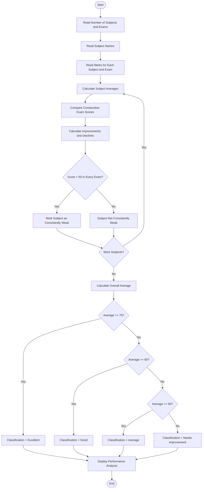

# Problem Statement
Design a Python program to analyze a student's performance across multiple examinations. The program should compare assessment scores in different subjects, calculate improvements and declines, identify consistently weak subjects, and classify the student based on their overall performance.

Classification criteria:
- Average ≥ 75% → Excellent
- Average 60%–74% → Good
- Average 50%–59% → Average
- Average below 50% → Needs Improvement
- A subject is considered consistently weak if its score is below 50 in every examination.
# Algorithm
1. Start.
2. Read the number of subjects and examinations.
3. Read the subject names.
4. Read marks for every subject in each examination.
5. Calculate the average score of each subject.
6. Compare scores between consecutive examinations.
7. Calculate improvement or decline for each subject.
8. Check whether a subject scored below 50 in every examination.
9. Mark such subjects as consistently weak.
10. Calculate the overall average of all examination scores.
11. Classify the student:
    - 75 or above → Excellent
    - 60–74 → Good
    - 50–59 → Average
    - Below 50 → Needs Improvement
12. Display subject-wise trends and weak subjects.
13. Display the overall average and classification.
14. Stop.
# Mermaid Flowchart

# sample input
Enter number of examinations: 3

Examination 1
Enter marks in Maths: 60
Enter marks in Physics: 45
Enter marks in Python: 70

Examination 2
Enter marks in Maths: 70
Enter marks in Physics: 42
Enter marks in Python: 75

Examination 3
Enter marks in Maths: 80
Enter marks in Physics: 48
Enter marks in Python: 85
