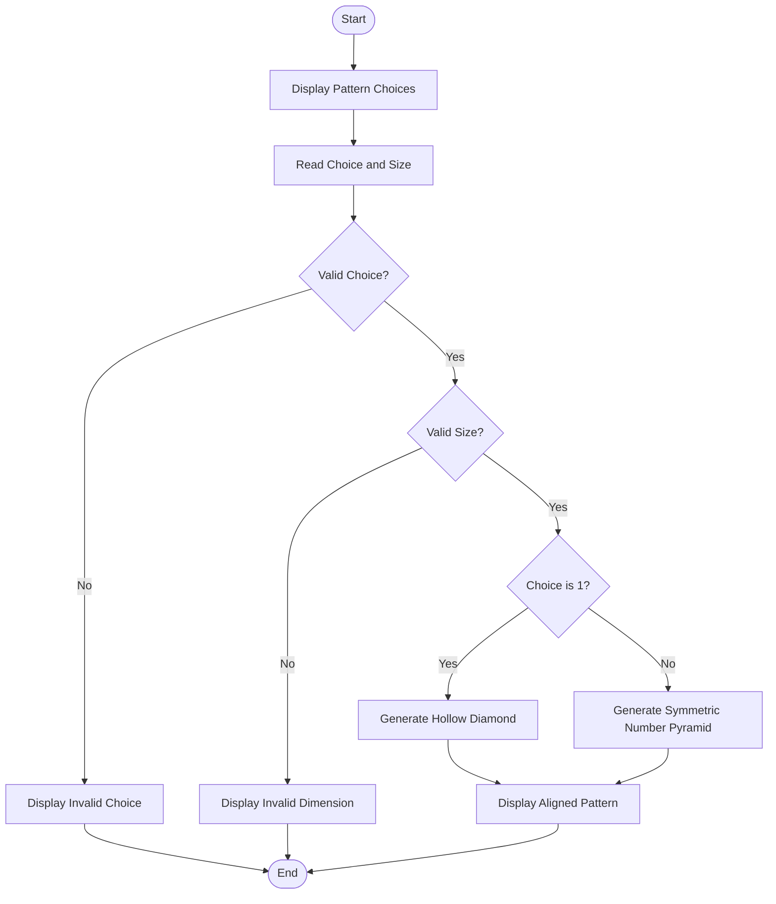

# Problem Statement
Develop a Python program to generate a hollow diamond or symmetric numerical pattern based on the user's choice and specified dimensions. The program must validate the input dimensions, reject invalid values, and display the pattern with proper spacing and alignment.

Assumptions:
- The user chooses either a hollow diamond or a symmetric number pyramid.
- The size must be a positive odd integer greater than or equal to 3 for the hollow diamond.
- Invalid choices and dimensions must be rejected.
- Numbers and spaces must be aligned symmetrically.
# Algorithm
1. Start.
2. Display the pattern choices: hollow diamond and symmetric number pyramid.
3. Read the user's choice and size.
4. Validate the choice and size.
5. If the input is invalid, display an error message.
6. If the user selects a hollow diamond:
   - Print the upper half using spaces and boundary numbers.
   - Print the lower half in reverse order.
7. If the user selects a symmetric number pyramid:
   - Print leading spaces.
   - Print numbers in increasing and decreasing order.
8. Display the completed pattern.
9. Stop.
# Mermaid Flowchart

# sample input
Enter your choice (1 or 2): 1
Enter pattern size: 5
