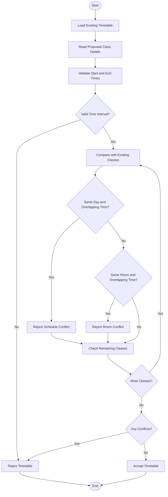

# Problem Statement
Develop a Python program to validate a student timetable using strings and tuples. The program should compare course schedules, detect overlapping class periods, identify unavailable rooms, and determine whether a proposed timetable is valid.

Assumptions:
- Each class is represented by a tuple containing course name, day, start time, end time, and room.
- Two classes conflict if they occur on the same day and their time periods overlap.
- A room is unavailable if it is already booked during an overlapping period.
- The timetable is valid only if there are no schedule conflicts or room conflicts.
# Algorithm
1. Start.
2. Define the list of existing class schedules using tuples.
3. Read the proposed course name, day, start time, end time, and room.
4. Convert the start and end times into comparable values.
5. Check whether the proposed class has a valid time interval.
6. Compare the proposed class with each existing class.
7. If the day is the same and the time periods overlap, report a schedule conflict.
8. If the room is the same and the time periods overlap, report a room conflict.
9. If no conflicts exist, accept the proposed timetable.
10. Otherwise, reject the proposed timetable and display the conflicts.
11. Stop.
# Mermaid Flowchart

# sample input
Enter Proposed Class Details
Course name: Chemistry
Day: Monday
Start time (HH:MM): 09:30
End time (HH:MM): 10:30
Room: R101

